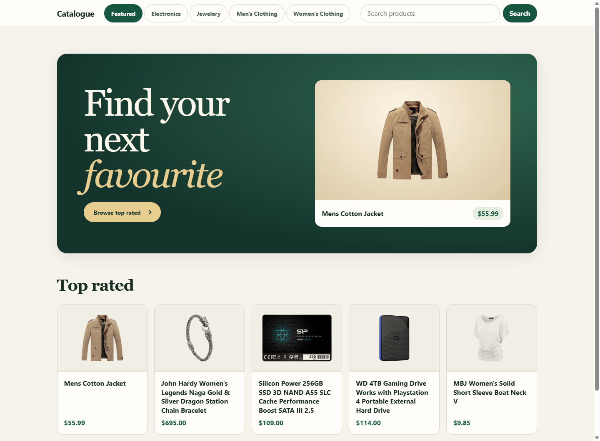
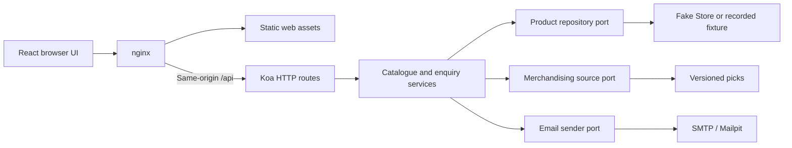

# Product catalogue PoC

A browsable product catalogue with curated picks, server-side search, and a product enquiry form. The API loads Fake Store product data, proxies the images, and routes enquiries to a sales inbox. The local inbox runs in Mailpit.



## Quick start

Start Docker and run this from the repository root.

```sh
docker compose up --build
```

Open the [catalogue](http://localhost:8080) and [Mailpit](http://localhost:8025). The [API health endpoint](http://localhost:3000/api/health) reports readiness. Stop the stack with `docker compose down`.

Set `PRODUCT_SOURCE=fixture` in the shell or in a git-ignored copy of `.env.example` to use the recorded catalogue and bundled images. The first Docker build pulls base images and npm packages.

```sh
PRODUCT_SOURCE=fixture docker compose up --build
```

### Try the catalogue

| Feature         | What to try                                                                                                                                                                                                              |
| --------------- | ------------------------------------------------------------------------------------------------------------------------------------------------------------------------------------------------------------------------ |
| Home            | Open **Featured**. The **Top rated** grid shows five products in the order set in the merchandising file.                                                                                                                |
| Categories      | Open **Electronics**. Two products appear in **Top rated**. The other four appear in **More in Electronics**.                                                                                                            |
| Search          | Search for `jackets`. Four results appear on `/search?q=jackets`. Try `xyz123` for the empty state.                                                                                                                      |
| Product details | Open **Mens Cotton Jacket**. Its image, price, rating, category, and description appear.                                                                                                                                 |
| Enquiry         | Select **Enquire about this product**. Enter a name and a test address such as `customer@example.com`. Submit and check the thank-you message and the email in Mailpit. The email's Reply-To is the address you entered. |

## Stack and architecture

React and Vite build the TypeScript UI as static assets. Koa provides a small async middleware layer, so routing, validation, and service boundaries stay explicit. Express and Fastify also support lightweight APIs. NestJS adds conventions and a dependency injection framework that this PoC can leave to the application. Zod schemas in the shared contracts workspace validate requests and responses. Mailpit exercises the same SMTP adapter used for a real relay.



| Change                     | Entry point                                                                                                                                                                                    |
| -------------------------- | ---------------------------------------------------------------------------------------------------------------------------------------------------------------------------------------------- |
| Curate the storefront      | Edit [merchandising.json](apps/api/config/merchandising.json) and restart the API.                                                                                                             |
| Restyle the UI             | Edit [theme tokens](apps/web/src/shared/theme/tokens.css) and the presentational components.                                                                                                   |
| Change search              | Edit the [search domain policy](apps/api/src/domain/search.ts).                                                                                                                                |
| Extend the enquiry form    | Update the [shared schema](packages/contracts/src/enquiry.ts), [form](apps/web/src/features/enquiry/components/EnquiryForm.tsx), and [email composer](apps/api/src/services/enquiry-email.ts). |
| Replace the product source | Add or select a [product adapter](apps/api/src/adapters/products), and use the repository contract suite.                                                                                      |
| Replace the mail relay     | Configure SMTP or add an [email adapter](apps/api/src/adapters/email) that implements the same port.                                                                                           |

The [decision log](DECISIONS.md#how-the-design-grows-beyond-the-poc) covers source ID migration, scaling caveats, and the AWS path.

## Configuration

The full defaults are in [`.env.example`](.env.example). Use the shell or a local `.env` to override them.

| Setting                                                                    | Default and purpose                                                                                                                 |
| -------------------------------------------------------------------------- | ----------------------------------------------------------------------------------------------------------------------------------- |
| `PRODUCT_SOURCE`                                                           | `fakestore`. Use `fixture` for an offline catalogue at runtime.                                                                     |
| `FAKESTORE_BASE_URL`, `UPSTREAM_TIMEOUT_MS`, `CATALOGUE_CACHE_TTL_SECONDS` | Fake Store URL, 5-second timeout, 300-second product cache.                                                                         |
| `CATALOGUE_CURRENCY`, `IMAGE_ALLOWED_HOSTS`, `MERCHANDISING_FILE`          | `AUD`, `fakestoreapi.com`, `config/merchandising.json` relative to the API workspace.                                               |
| `SALES_INBOX_EMAIL`, `ENQUIRY_FROM_EMAIL`                                  | `sales@example.com` and `enquiries@example.com`.                                                                                    |
| `SMTP_HOST`, `SMTP_PORT`, `SMTP_SECURE`                                    | Compose uses `mailpit:1025`. Local Node uses `localhost:1025`. TLS is off for Mailpit. Set credentials only for a configured relay. |
| `ENQUIRY_RATE_LIMIT_MAX`, `ENQUIRY_RATE_LIMIT_WINDOW_SECONDS`              | Five submissions per client IP per 600 seconds.                                                                                     |
| `PUBLIC_WEB_URL`                                                           | The local site URL used in enquiry emails. Compose derives it from `WEB_PORT`.                                                      |
| `WEB_PORT`, `API_PORT`, `MAILPIT_UI_PORT`                                  | Published Docker ports `8080`, `3000`, `8025`.                                                                                      |

For a busy port, set the corresponding variable, for example `WEB_PORT=8081 docker compose up --build`. If Fake Store is unreachable, start with `PRODUCT_SOURCE=fixture`.

## Development and verification

Use Node.js 24 and Docker to run the API and Vite on the host.

```sh
npm ci
npm run dev
```

Vite runs at <http://localhost:5173> and proxies `/api` to Koa. The dev command starts Mailpit in Docker.

| Command                              | Purpose                                                                                                                                                                          |
| ------------------------------------ | -------------------------------------------------------------------------------------------------------------------------------------------------------------------------------- |
| `npm run verify`                     | Format check, lint, typecheck, and offline tests across all workspaces.                                                                                                          |
| `npm run build`                      | Build contracts, API, and production web assets.                                                                                                                                 |
| `bash scripts/smoke.sh`              | Build an isolated fixture-mode Docker stack, verify API health and curation, and check that one accepted enquiry reaches Mailpit. The script tears down its stack when it exits. |
| `npm run snapshot -w @catalogue/api` | Refresh the recorded catalogue from Fake Store.                                                                                                                                  |

If a preview is running, give the smoke stack different ports. Use Bash on Linux, macOS, or Git Bash on Windows.

```sh
WEB_PORT=18085 API_PORT=13085 MAILPIT_UI_PORT=18029 bash scripts/smoke.sh
```

## Time spent

| Activity                                     |                    Actual time |
| -------------------------------------------- | -----------------------------: |
| Planning                                     |                        2 hours |
| Building (specification and code generation) |                        2 hours |
| Testing                                      |                         1 hour |
| Reviewing                                    | 15–20 minutes per phase review |
| **Subtotal before reviewing**                |                    **5 hours** |

See the [implementation plan](docs/PLAN.md), [decisions](DECISIONS.md), [security controls](SECURITY.md), and [AI usage record](AI_USAGE.md).
